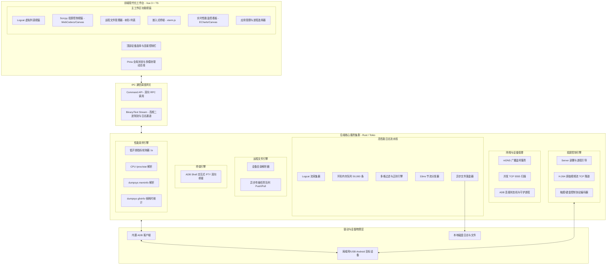
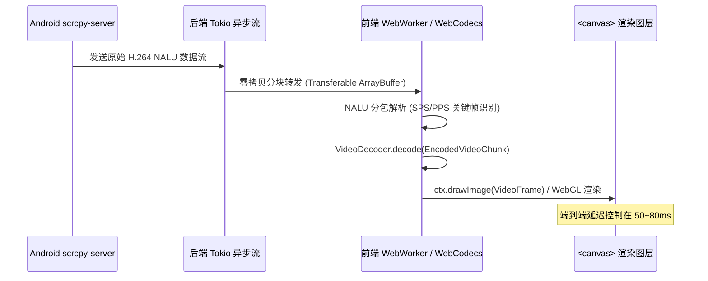
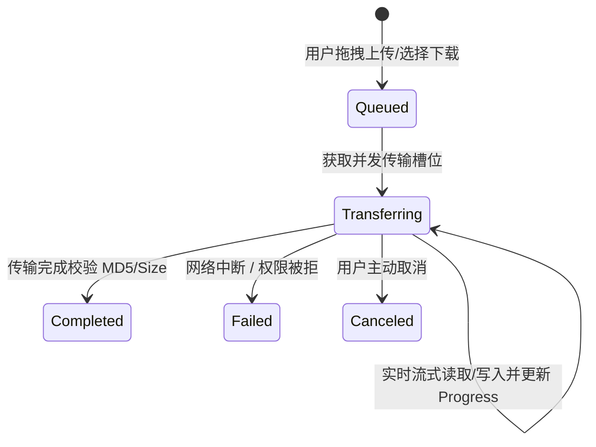

# Android 设备局域网管理与实时 Logcat 分析工具 — 软件设计与开发文档 (TDD)

**文档版本**：v1.1.0
**状态**：已定稿
**面向对象**：系统架构师、客户端开发工程师、前端开发工程师

---

## 1. 技术栈选型与架构决策

### 1.1 技术栈对比与评估

| 选型方案 | GUI 渲染层 | 核心引擎层 (后台) | 内存占用 | 实时吞吐性能 (日志/视频流) | 跨平台发布体积 | 推荐指数 |
| :--- | :--- | :--- | :--- | :--- | :--- | :--- |
| **方案 A (强烈推荐)<br>Tauri 2.0 + Vue 3/TS** | Webview2 / WebKit<br>Vue 3 + TailwindCSS | **Rust**<br>(Tokio 异步运行时) | **极低** (~45MB 含投屏) | **极高** (Rust 原生异步管道、H.264 分包、零 GC 停顿) | **极小** (~18MB 安装包) | ⭐⭐⭐⭐⭐ |
| **方案 B (成熟通用)<br>Electron + Vue 3/TS** | Chromium<br>Vue 3 + Element Plus | **Node.js**<br>(Child Process / Stream) | 偏高 (~160MB+) | 良好 (需借助 Worker 线程隔离日志与视频流解析) | 较大 (~90MB 安装包) | ⭐⭐⭐⭐ |
| **方案 C (极简脚本)<br>PySide6 (Qt for Python)** | Qt Widgets / QML | **Python 3**<br>(asyncio / QThread) | 中等 (~110MB) | 中等 (GIL 锁对高频视频解码和并发日志有性能天花板) | 偏大 (PyInstaller 打包 ~70MB) | ⭐⭐⭐ |

### 1.2 最终技术选型推荐
**基线架构：Tauri 2.0 + Rust + Vue 3 + TypeScript + Vite + Tailwind CSS + WebCodecs**
- **核心考量**：
  1. **Logcat 高吞吐**：Rust 多线程与环形缓冲区从根本上解决高频日志解析与内存暴涨问题。
  2. **Scrcpy 投屏低延迟**：通过 Rust 转发 TCP Socket 原始 H.264 视频流至前端，前端利用浏览器原生的 **WebCodecs API** (`VideoDecoder`) 进行 GPU 硬件加速解码，直接渲染到 `<canvas>`，端到端延迟控制在 50~80ms，杜绝中间格式转码开销。
  3. **终端与文件传输**：Rust 原生 Tokio 异步 I/O 提供高性能的双向 PTY 管道与大文件推拉传输。

---

## 2. 系统总体架构设计

系统采用**工作台微模块架构 (Workbench Modular Architecture)**。系统分为五大核心域：



---

## 3. 核心子系统详细设计

### 3.1 局域网 Android 设备发现与连接模块
- **双轨扫描**：mDNS 监听 `_adb-tls-connect._tcp` 广播；结合网卡活跃子网（如 `192.168.1.0/24`）多协程/多线程并发探测 `5555` 端口（单 IP 超时 150ms）。
- **状态感知**：状态机管理 `Disconnected -> Connecting -> Online / Unauthorized / Offline`。

---

### 3.2 设备硬件与系统信息获取设计
设备上线后并行拉取设备基础画像：
- `getprop ro.product.manufacturer / model / cpu.abi`
- `wm size && wm density`
- `dumpsys battery`
- 格式化封装为 `DeviceDetailInfo` 供顶部栏与概览页消费。

---

### 3.3 已安装应用列表提取与 PID 动态追踪
- **应用分类提取**：`pm list packages -3 -f`（第三方）与 `-s -f`（系统），匹配应用 Label。
- **动态 PID 监控 (PidWatcher)**：轮询监听 `pidof <package_name>`。应用未启动时进入挂起监听状态，一旦启动立刻无感挂载 PID 到 Logcat 与性能监控引擎。

---

### 3.4 高吞吐实时 Logcat 数据流水线
- **数据流转**：`stdout -> Regex Parser -> RingBuffer(50,000) -> Filter Engine -> Batcher(33ms/200条) -> IPC -> Virtual Scroll Viewport`。
- **渲染防护**：前端使用虚拟列表只渲染可见区域（40~60行），无论日志累积多少万条，内存平稳，帧率恒定 60 FPS。
- **异步双写落盘**：文件保存独立于 UI，直接由后端异步 BufWriter 写入磁盘，界面暂停或筛选时不影响日志完整记录。

---

### 3.5 设备投屏与实时交互控制子系统 (Scrcpy Engine)

#### 3.5.1 服务端部署与生命周期建立
1. **Jar 推送**：客户端启动投屏时，检查设备 `/data/local/tmp/scrcpy-server.jar` 是否存在或版本一致，缺失则调用 `adb push` 自动推送到设备。
2. **启动 Server**：
   ```bash
   adb -s <dev> forward tcp:LOCAL_PORT localabstract:scrcpy
   adb -s <dev> shell CLASSPATH=/data/local/tmp/scrcpy-server.jar \
       app_process / com.genymobile.scrcpy.Server 2.4 \
       max_size=1080 video_bit_rate=8000000 max_fps=60 \
       tunnel_forward=true control=true
   ```
3. **建立双 Socket 通道**：
   - **Video Socket**：读取 H.264 原始视频流（带 68 字节设备元信息头 + NALU 单元）。
   - **Control Socket**：双向传输控制命令（二进制数据包）。

#### 3.5.2 视频流解码与低延迟渲染方案


- **WebCodecs 核心实现**：利用现代浏览器原生的硬件加速解码器 `VideoDecoder`：
  ```typescript
  const decoder = new VideoDecoder({
    output: (frame: VideoFrame) => {
      renderCanvas(frame);
      frame.close();
    },
    error: (e) => console.error(e)
  });
  decoder.configure({ codec: 'avc1.64002a', hardwareAcceleration: 'prefer-hardware' });
  ```

#### 3.5.3 控制协议编码设计 (Control Protocol)
客户端监听 Canvas 鼠标/键盘事件，按 Scrcpy 二进制协议格式打包写入 Control Socket：
- **触摸事件 (Inject Touch)**：
  - 结构体：`[Type: 1B] [Action: 1B] [PointerID: 8B] [X: 4B] [Y: 4B] [Width: 2B] [Height: 2B] [Pressure: 2B] [Buttons: 4B]`
  - Action 对应：Down (0), Move (1), Up (2)。
- **按键事件 (Inject Keycode)**：
  - 发送 Android Keycode（如 `KEYCODE_BACK = 4`, `KEYCODE_HOME = 3`, `KEYCODE_POWER = 26`）。
- **文本注入与剪贴板**：直接发送 UTF-8 文本序列包，实现电脑输入法向手机直接键入中文。

---

### 3.6 远程文件管理器子系统 (File Explorer Engine)

#### 3.6.1 目录结构拉取与解析
- 采用 `adb shell ls -la --time-style=+%s <path>` 命令流，单条命令同时获取权限位、所有者、大小、时间戳与名称：
  - 正则解析规则：`^([\w-]{10})\s+(\d+)\s+(\w+)\s+(\w+)\s+(\d+)\s+(\d+)\s+(.+)$`
  - 符号链接标记与目标路径提取 (`name -> target`)。
- 树形结构缓存：采用 LRU 缓存已展开目录节点，避免重复读取网络。

#### 3.6.2 异步传输通道与进度状态机 (Transfer Pipeline)


- **上传 (Push)**：流式读取本地文件并分块（64KB Chunk）通过 `adb push` 管道传输，通过进度事件向前端推送 `transferred_bytes`、`total_bytes`、`speed_mbps`。
- **下载 (Pull)**：调用异步拉取流，写入本地目标目录。

---

### 3.7 嵌入式 Shell 交互终端子系统 (Interactive Terminal Engine)

#### 3.7.1 架构设计
- **前端渲染**：基于 `xterm.js`，集成 `@xterm/addon-fit`（自动适配尺寸）、`@xterm/addon-web-links`。
- **后端 PTY 桥接**：
  - 后端拉起 `adb -s <dev> shell` 子进程，绑定子进程的 `stdin/stdout/stderr` 到双向异步通道。
  - 前端击键 -> IPC -> 写入子进程 `stdin`。
  - 子进程 `stdout` 捕获 -> IPC -> 前端 `terminal.write()`。
- **动态尺寸适配 (Window Resize)**：
  - 前端监听窗口尺寸改变，通过 FitAddon 计算 `cols` 与 `rows`。
  - 向后端发送 `ResizeTerminal(cols, rows)`，后端发送 `stty cols <C> rows <R>` 保证 `top`、`vi` 等程序排版正常。
- **多 Tab 会话隔离**：维护 `SessionMap<sessionId, ChildProcess>`，每个 Tab 拥有独立的会话上下文。

---

### 3.8 实时性能监控看板子系统 (Performance Monitoring Engine)

#### 3.8.1 采样调度策略
- **按需采样**：仅当性能看板处于可见激活状态，或用户启动“后台录制性能”时，定时器（默认 1000ms）才启动工作，不额外消耗测试机资源。

#### 3.8.2 多维指标计算算法
1. **CPU 占用率**：
   - 连续两次采样目标进程 `/proc/<pid>/stat` 中的 `utime + stime`，以及系统 `/proc/stat` 的总 CPU 时间 `total_time`。
   - 算法公式：
     $$\text{CPU}_{\text{app}}\% = \frac{\Delta (\text{utime} + \text{stime})}{\Delta \text{total\_time}} \times \text{CoreCount} \times 100\%$$
2. **内存细分构成 (Memory Breakdown)**：
   - 执行 `dumpsys meminfo <package> -d`，正则捕获下述关键数据项：
     - **Java Heap PSS**
     - **Native Heap PSS**
     - **Graphics PSS** (GPU 显存)
     - **Code / Stack PSS**
     - **TOTAL PSS & Private Dirty**
3. **渲染帧率与卡顿 (FPS & Jank)**：
   - 执行 `dumpsys gfxinfo <package> framestats`。
   - 分析最近 120 帧的时间戳数组，计算每帧的总渲染耗时：
     $$T_{\text{frame}} = T_{\text{FrameCompleted}} - T_{\text{IntendedVsync}}$$
   - 若 $T_{\text{frame}} > 16.66\text{ms}$（针对 60Hz 屏幕），计为 1 次慢帧 (Slow Frame)；若超过 30ms 计为 1 次严重卡顿 (Jank)。
4. **网络速率**：
   - 读取 `/proc/uid_stat/<uid>/tcp_rcv` 与 `tcp_snd`，两次采样差值除以时间间隔获取实时 KB/s 带宽。

---

## 4. 核心数据结构与接口契约

### 4.1 数据模型扩展 (TypeScript / IPC Models)

```typescript
// 1. 投屏配置
export interface ScrcpyOptions {
  maxSize: number;          // 720 | 1080 | 0 (原生)
  bitRate: number;          // 默认 8000000 (8Mbps)
  maxFps: number;           // 30 | 60
  stayAwake: boolean;       // 投屏时保持常亮
  turnScreenOff: boolean;   // 投屏时熄灭物理屏幕
}

// 2. 投屏控制动作
export interface ControlEventPayload {
  action: 'touch_down' | 'touch_move' | 'touch_up' | 'key_code' | 'text' | 'scroll';
  x?: number;               // 归一化坐标 0.0 ~ 1.0
  y?: number;
  keyCode?: number;         // Android Keycode
  text?: string;
  scrollDelta?: number;
}

// 3. 远程文件节点
export interface RemoteFileItem {
  name: string;
  path: string;
  isDirectory: boolean;
  isSymlink: boolean;
  size: number;             // 字节
  permissions: string;      // 例如 "drwxr-xr-x"
  modifyTime: number;       // Unix 时间戳
  ext?: string;
}

// 4. 文件传输任务
export interface FileTransferTask {
  taskId: string;
  direction: 'push' | 'pull';
  localPath: string;
  remotePath: string;
  totalBytes: number;
  transferredBytes: number;
  speedBps: number;
  status: 'pending' | 'transferring' | 'completed' | 'failed' | 'canceled';
  error?: string;
}

// 5. 性能监控采样切片
export interface PerfMetricsSample {
  timestamp: number;
  cpu: {
    appPercent: number;     // 目标应用占用 0~100%
    systemPercent: number;  // 系统整体占用 0~100%
  };
  memory: {
    totalPss: number;       // KB
    javaHeapPss: number;
    nativeHeapPss: number;
    graphicsPss: number;
    privateDirty: number;
  };
  fps: {
    currentFps: number;
    jankCount: number;      // 过去 1 秒内卡顿次数
    frameTimeMs: number;    // 当前平均帧耗时
  };
  network: {
    rxBytesPerSec: number;  // 下载速率
    txBytesPerSec: number;  // 上传速率
  };
  battery: {
    level: number;          // 百分比
    temperature: number;    // 摄氏度 (如 36.5)
  };
}
```

---

## 5. 项目完整目录结构规范

```text
ADBLOG/
├── .gitignore
├── 需求文档.md
├── 开发文档.md
├── src-tauri/                   # 后端核心工程 (Rust / Tokio)
│   ├── Cargo.toml
│   ├── tauri.conf.json
│   ├── src/
│   │   ├── main.rs              # 主入口与生命周期
│   │   ├── adb/                 # ADB 客户端与连接管理
│   │   │   ├── client.rs
│   │   │   ├── parser.rs
│   │   │   └── process.rs
│   │   ├── discovery/           # 局域网扫描器 (mDNS + TCP 并发)
│   │   │   ├── mdns.rs
│   │   │   └── port_scan.rs
│   │   ├── logcat/              # Logcat 核心流水线
│   │   │   ├── ring_buffer.rs   # 环形队列
│   │   │   ├── filter.rs        # 过滤引擎
│   │   │   ├── stream.rs        # 数据流捕获
│   │   │   └── file_sink.rs     # 异步落盘
│   │   ├── scrcpy/              # Scrcpy 投屏控制子系统
│   │   │   ├── bootstrap.rs     # Server 部署与启动引导
│   │   │   ├── video_stream.rs  # H.264 原始流传输
│   │   │   └── control.rs       # 触控与按键编码
│   │   ├── files/               # 远程文件引擎
│   │   │   ├── explorer.rs      # 目录扫描与属性解析
│   │   │   └── transfer.rs      # 异步流式 Push/Pull
│   │   ├── terminal/            # 嵌入式终端
│   │   │   └── pty_session.rs   # ADB Shell 双向 PTY 会话
│   │   ├── perf/                # 性能采样引擎
│   │   │   ├── poller.rs        # 定时器调度
│   │   │   ├── cpu.rs           # /proc/stat 解析
│   │   │   ├── mem.rs           # dumpsys meminfo 解析
│   │   │   └── gfx.rs           # dumpsys gfxinfo 帧分析
│   │   └── commands/            # Tauri IPC 指令分发集
│   │       ├── device_cmd.rs
│   │       ├── logcat_cmd.rs
│   │       ├── scrcpy_cmd.rs
│   │       ├── file_cmd.rs
│   │       ├── terminal_cmd.rs
│   │       └── perf_cmd.rs
│   └── bin/                     # 内置运行依赖环境
│       ├── adb.exe              # 可选内置 ADB 二进制
│       └── scrcpy-server.jar    # 内置 Scrcpy 服务端核心 Jar
├── src/                         # 前端工程 (Vue 3 + TypeScript)
│   ├── main.ts
│   ├── App.vue
│   ├── layout/                  # 工作台主框架布局
│   │   ├── WorkbenchHeader.vue  # 顶部设备选择、状态与全局控制
│   │   ├── ActivityBar.vue      # 左侧功能模块切换条
│   │   └── StatusBar.vue        # 底部状态、速率与录制指示
│   ├── views/                   # 六大核心主视窗
│   │   ├── logcat/              # Logcat 主面板 (虚拟表格、过滤条)
│   │   ├── scrcpy/              # 投屏面板 (WebCodecs Canvas、按键浮窗)
│   │   ├── files/               # 文件管理器 (文件树、文件列表、传输抽屉)
│   │   ├── terminal/            # Shell 终端面板 (xterm.js 多 Tab 视窗)
│   │   ├── perf/                # 性能监控面板 (CPU/内存/FPS 动态图表)
│   │   └── device/              # 设备画像卡片与应用选择抽屉
│   ├── components/              # 通用业务组件
│   ├── composables/             # 组合式业务逻辑
│   │   ├── useAdb.ts
│   │   ├── useLogcat.ts
│   │   ├── useScrcpy.ts
│   │   ├── useFileExplorer.ts
│   │   ├── useTerminal.ts
│   │   └── usePerfMonitor.ts
│   ├── stores/                  # Pinia 全局状态仓 (device, logcat, files, perf)
│   └── styles/
├── package.json
├── tsconfig.json
└── vite.config.ts
```

---

## 6. 开发实施计划与完整里程碑

| 阶段 | 核心任务与产出 | 关键交付物与验收标准 |
| :--- | :--- | :--- |
| **Phase 1: 基础设施与设备发现 (Day 1-3)** | 搭建 Tauri + Vue 3 工程骨架；集成内嵌 ADB 与 Scrcpy-Server 资源；实现局域网设备扫描与无线 TCP/IP 连接；展示设备硬件画像。 | 能够扫描内网设备，成功执行 `adb connect` 并显示设备详情。 |
| **Phase 2: Logcat 核心流水线 (Day 4-7)** | 实现后端环形缓冲区与多维过滤；前端完成虚拟滚动表格、级别分色、动态 PID 绑定、关键词/正则搜索与异步文件实时落盘。 | 日志流 10,000 条/s 冲击下 UI 滚动流畅，搜索过滤 50ms 响应，文件完整保存。 |
| **Phase 3: Scrcpy 投屏与触控交互 (Day 8-11)** | 实现 `scrcpy-server.jar` 自动部署与启动；完成基于 WebCodecs 的 H.264 视频流解码渲染；实现鼠标触控映射、键盘输入与物理按键侧边栏。 | 局域网投屏延迟 $\le 80\text{ms}$，鼠标能直接点击滑动操作手机，支持中文输入。 |
| **Phase 4: 文件管理与嵌入式 Shell (Day 12-14)** | 构建基于 `xterm.js` 的终端会话与 PTY 通信；开发设备远程文件管理器，实现文件树浏览、拖拽上传、批量下载与传输队列进度监控。 | Shell 终端可执行命令并支持 Tab 补全；文件管理器可直接拖拽文件推送至手机。 |
| **Phase 5: 性能监控看板与联调打磨 (Day 15-18)** | 实现低开销 CPU、内存构成 (PSS)、FPS 掉帧与网络采样引擎；前端构建动态趋势折线图；支持性能报表 CSV 导出；多模块联调。 | 性能监控平稳运行（CPU开销<2%），能准确捕获应用内存泄漏与掉帧峰值。 |
| **Phase 6: 打包构建与跨平台测试 (Day 19+)** | Windows / macOS / Linux 三端打包测试；极端网络断线自愈测试；编写发布手册。 | 产出轻量桌面端安装包，开箱即用。 |
